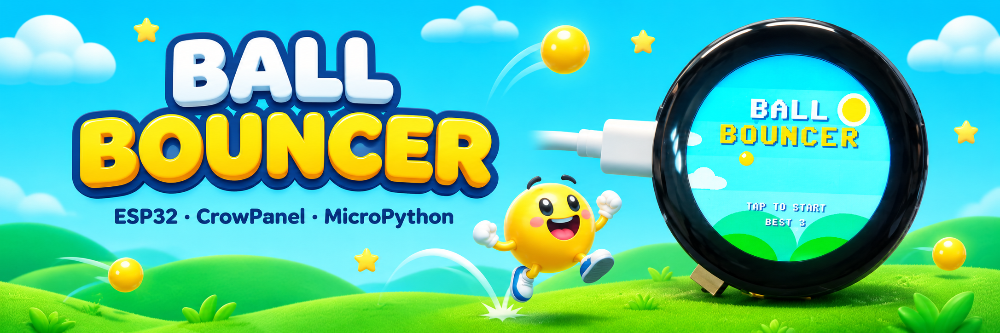

# BallBouncer

Ein kleines Ein-Finger-Spiel für das **Elecrow CrowPanel 1.28" Round Display** (ESP32-C3), geschrieben in MicroPython.
Ein gelber Ball fällt durch eine Landschaft, ein Tipp auf das Display lässt ihn springen. Dazwischen hängen
anthrazitfarbene Kugelketten, deren Lücke auf und ab schwingt.

Vom Spielprinzip der Ein-Tipp-Hüpfspiele inspiriert (u. a. Flappy Bird); Grafik, Ton und Code sind eigenständig.
Es besteht keine Verbindung zu den Rechteinhabern dieses Vorbilds.

<p align="center">
  
</p>

*Der Titelbildschirm von BallBouncer auf dem CrowPanel.*

---

## Spielablauf

| Phase | Was passiert |
| --- | --- |
| **Titel** | „ORBIT HOP“ mit Bestwert. Ein Tipp auf das Display startet das Spiel. |
| **Spiel** | Der Ball schwebt auf fester Höhe im linken Drittel, die Kugelketten wandern von rechts nach links. Mit jedem **Tipp** springt der Ball (rund 47 px hoch), sonst fällt er. Die Lücke zwischen den Ketten schwingt auf und ab. |
| **Punkte** | Pro vollständig passierter Kugelgruppe gibt es einen Punkt (hoher Piepton). Das Tempo steigt langsam mit der Punktzahl. |
| **Game Over** | Der Ball berührt eine Kugel **oder den Rand des runden Displays**: tiefer Ton, kurze Vibration. Punktzahl und Bestwert werden angezeigt, ein Tipp startet neu. |

Der Bestwert wird in der Datei `highscore.txt` im Flash des Boards gespeichert.

---

## Hardware

| Bauteil | Details |
| --- | --- |
| Board | Elecrow CrowPanel 1.28" Round Display, 42 × 42 mm |
| Mikrocontroller | ESP32-C3 (RISC-V, 160 MHz, ca. 400 KB SRAM, kein PSRAM) |
| Display | GC9A01, 240 × 240 Pixel, rund, IPS, per SPI |
| Touch | CST816D, kapazitiv, I²C-Adresse `0x15` |
| IO-Expander | PI4IOE5V6408, I²C-Adresse `0x43` (schaltet Display, Touch und Vibrationsmotor) |
| Ton | Buzzer an GPIO 3 (PWM) |
| Rückmeldung | Vibrationsmotor, über IO-Expander-Pin 0 |
| Sonstiges | Drehencoder mit Druckknopf (im Spiel nicht genutzt, zu klein zum Spielen), RTC BM8563 auf `0x51` |

Belegung, soweit im Spiel verwendet:

| Funktion | Pin |
| --- | --- |
| I²C SDA / SCL | GPIO 4 / GPIO 5 |
| Display SCK / MOSI / CS / DC | GPIO 6 / 7 / 10 / 2 |
| Touch-Interrupt | GPIO 0 |
| Buzzer | GPIO 3 |
| Expander-Pins | 2 und 4 = Display bzw. Hintergrundbeleuchtung, 1 bis 7 außer 0 werden beim Start hochgesetzt (u. a. Touch-Versorgung), 0 = Vibration |

### Besonderheiten dieses Boards

- **Speicher:** Ein 240×240-Framebuffer (115 KB) passt nicht in den freien Heap des C3. Das Spiel zeichnet deshalb in
  **drei Bändern zu je 80 Zeilen** (`display_partial.py`, 38 KB) und sendet jedes Band einzeln ans Display.
- **Touch:** Der CST816D antwortet erst am I²C-Bus, wenn der IO-Expander alle Pins außer 0 high hat (`main.py` erledigt das).
- **Farben:** Das Panel erwartet RGB565 mit vertauschten Bytes; `rgb()` in `game.py` rechnet das um.
- **Vibration:** Der Expander behält seinen Ausgangszustand über einen Soft-Reboot hinweg. `main.py` schaltet Pin 0 deshalb
  beim Start ausdrücklich aus.

---

## Installation

Das Spiel wurde mit [Thonny](https://thonny.org/) entwickelt; damit lässt sich das Board auch einfach flashen und
bespielen. Alle Schritte unten beziehen sich darauf.

### 1. MicroPython auf das Board bringen

Es genügt die Standard-Firmware für den ESP32-C3, eine spezielle Herstellerversion ist nicht nötig.

1. Board per USB-C mit dem Rechner verbinden.
2. In Thonny: **Run → Configure interpreter…** und als Interpreter **MicroPython (ESP32)** sowie den Port des Boards wählen.
3. Unten rechts auf **Install or update MicroPython (esptool)** klicken.
4. Im Dialog Port und die Variante **ESP32-C3** wählen, eine MicroPython-Version auswählen und **Install** drücken.

Danach meldet sich die Konsole mit `>>>`. Ist schon MicroPython aufgespielt, kann dieser Schritt entfallen.
(Alternativ lässt sich die Firmware von <https://micropython.org/download/ESP32_GENERIC_C3/> mit esptool flashen.)

### 2. Treiber des Herstellers nach `/lib`

Aus dem Ordner `lib/` dieses Repos (unveränderte Treiber des Herstellers) auf das Board nach `/lib` kopieren:

- `gc9a01.py`
- `cst816d.py`
- `pi4ioe5v6408ztaex.py`

### 3. Spiel kopieren

Diese drei Dateien in das **Hauptverzeichnis** des Boards legen:

- `main.py`
- `game.py`
- `display_partial.py`

**In Thonny** (**View → Files** einblenden): Links die Dateien dieses Repos, rechts das Board
(„MicroPython device“). Auf dem Board bei Bedarf mit Rechtsklick → **New directory…** den Ordner `lib` anlegen.
Dann jede Datei per Rechtsklick → **Upload to /** bzw. im Ordner `lib` → **Upload to /lib** hochladen.
Alternativ eine Datei öffnen und **Datei → Speichern unter… → MicroPython-Gerät** wählen.

**Mit `mpremote`** (`pip install mpremote`):

```
mpremote mkdir lib
mpremote cp lib/gc9a01.py :lib/
mpremote cp lib/cst816d.py :lib/
mpremote cp lib/pi4ioe5v6408ztaex.py :lib/
mpremote cp main.py game.py display_partial.py :
mpremote reset
```

(`mpremote mkdir lib` meldet einen Fehler, falls der Ordner schon existiert; das ist unkritisch.)

Da die Datei `main.py` beim Einschalten automatisch ausgeführt wird, startet das Spiel beim Einstecken des USB-Kabels von selbst.
Zum Testen kann `main.py` in Thonny auch direkt mit **Run** gestartet werden.

---

## Einstellungen

Oben in `game.py`:

| Variable | Standard | Bedeutung |
| --- | --- | --- |
| `SOUND` | `False` | Töne ein/aus (Vibration bleibt davon unberührt) |
| `JUMP`, `GRAVITY`, `VMAX` | `-290`, `900`, `420` | Sprungkraft und Fallverhalten |
| `GAP` | `84` | Größe der Lücke zwischen den Kugelketten |
| `AMP`, `OSC` | `20`, `2.6` | Ausschlag und Tempo der schwingenden Lücke |
| `SPACING`, `SPEED0`, `SPEED_MAX` | `125`, `75`, `130` | Abstand der Gruppen und Scrolltempo |

Nach Änderungen die Datei neu auf das Board kopieren.

---

## Fehlersuche

| Symptom | Ursache und Abhilfe |
| --- | --- |
| `MemoryError: memory allocation failed, allocating 115200 bytes` | Es wird der Vollbild-Treiber `gc9a01.LCD_1inch28` statt `display_partial.LCDPartial` benutzt, oder das Display wird zu spät angelegt. `main.py` unverändert verwenden. |
| `OSError: [Errno 19] ENODEV` beim Touch | Der Expander hat die Touch-Versorgung nicht geschaltet. `main.py` verwenden (setzt die Expander-Pins 1 bis 7). Ob `0x15` am Bus erscheint, zeigt ein I²C-Scan. |
| Dauerhafte Vibration | Expander-Pin 0 steht auf high. `main.py` verwenden, oder USB kurz abziehen. |
| Falsche Farben | Die Umrechnung `rgb()` in `game.py` prüfen. |
| Kein Ton | `SOUND` steht standardmäßig auf `False`. Auf `True` setzen; der Buzzer hängt an GPIO 3. |
| Spiel ruckelt | Pro Bild wird die Szene dreimal gezeichnet (Bänder). Wolken oder Hügel in `draw_scenery()` vereinfachen. |

---

## Dateien

| Datei | Zweck |
| --- | --- |
| `main.py` | Startpunkt: IO-Expander, Display (zuerst, wegen des Speichers), dann das Spiel |
| `game.py` | Spiel, Landschaft, Touch, Ton, Vibration |
| `display_partial.py` | Speicherschonender Display-Treiber (240 × 80 Pixel Framebuffer) |
| `lib/` | Treiber des Herstellers (Display, Touch, IO-Expander), unverändert |
| `resources/` | Foto des Spiels für diese README |

## Lizenzen

Der Spielcode ist eigenständig geschrieben. Die Treiber `gc9a01.py`, `cst816d.py` und `pi4ioe5v6408ztaex.py` stammen
vom Hersteller (Elecrow) und unterliegen dessen Bedingungen. Grafiken werden zur Laufzeit aus einfachen Formen erzeugt,
Töne sind einfache Rechtecksignale des Buzzers. Vor einer Veröffentlichung den Namen „BallBouncer“ auf Kennzeichenrechte prüfen.
